 

  

  

### ✦ WELCOME TO MY UNIVERSE ✦

*Somewhere between imagination and engineering, ideas become reality.*

---

<h2 align="center">Ⅰ &nbsp; THE EXPLORER</h2>

I'm **Mohammad Sadeghi** — a self-taught software developer and the founder of **TEKA**.

I enjoy exploring technology, building digital experiences, and turning ambitious ideas into
independent projects — web development, blockchain, software architecture and emerging tech.

> **TEKA was designed, engineered, tested and operated end-to-end by one person —
> not out of pride, but out of necessity: there was no one else.**

**THINK BEYOND. BUILD WITH PURPOSE. KEEP EXPLORING.**

 

---

<h2 align="center">Ⅱ &nbsp; THE TEKA UNIVERSE</h2>

**A social network for developers + a free 300-lesson coding academy + 12 coding-game
modules — one installable PWA in 7 languages. Built solo, shipped live.**

`Next.js 16` `TypeScript 5` `PWA` `WebGL` `socket.io` `Prisma` `PostgreSQL` `v1.75.0`

 

  

 

---

<h2 align="center">Ⅲ &nbsp; TECHNOLOGY CONSTELLATION</h2>

<h3>◈ FRONTEND</h3>

<h3>◈ BACKEND & RUNTIME</h3>

<h3>◈ BLOCKCHAIN & TOOLS</h3>

---

<h2 align="center">Ⅳ &nbsp; GITHUB OBSERVATORY</h2>

  

  

<a href="https://github.com/mhmdsdqi87-cloud/TEKA-NEXUS">
  <picture>
    <source media="(prefers-color-scheme: dark)" srcset="https://api.star-history.com/svg?repos=mhmdsdqi87-cloud/TEKA-NEXUS&type=Date&theme=dark"/>
    <source media="(prefers-color-scheme: light)" srcset="https://api.star-history.com/svg?repos=mhmdsdqi87-cloud/TEKA-NEXUS&type=Date"/>
    
  </picture>
</a>

  

<picture>
  <source media="(prefers-color-scheme: dark)" srcset="https://raw.githubusercontent.com/mhmdsdqi87-cloud/mhmdsdqi87-cloud/output/github-contribution-grid-snake-dark.svg"/>
  <source media="(prefers-color-scheme: light)" srcset="https://raw.githubusercontent.com/mhmdsdqi87-cloud/mhmdsdqi87-cloud/output/github-contribution-grid-snake.svg"/>
  
</picture>

---

<h2 align="center">Ⅴ &nbsp; THE DREAM</h2>

**Dream is: ITMO · KFU · RU.**

A self-taught developer from Iran with one course plotted on the star map: studying
computer science in Russia — **ITMO University** (Saint Petersburg) or **Kazan Federal
University** (Kazan). Every repository here is a self-built rung on that ladder: no
degree, no teachers, no team — only the internet, long nights and stubbornness.

> 🎓 *«В надежде на учёбу в России» — this profile is a living portfolio, not proof of
> knowing, but evidence of wanting. Open to academic and professional opportunities.*

---

<h2 align="center">Ⅵ &nbsp; NEXT FRONTIERS</h2>

<table>
<tr>
<td align="center" width="33%">
<h3>🚀</h3>
<b>TEKA ECOSYSTEM</b>
 
Building and expanding independent technology projects.
</td>
<td align="center" width="33%">
<h3>⛓️</h3>
<b>WEB3 & BLOCKCHAIN</b>
 
Exploring decentralized technologies and smart contracts.
</td>
<td align="center" width="33%">
<h3>🧠</h3>
<b>SOFTWARE & AI</b>
 
Learning, experimenting, and creating new experiences.
</td>
</tr>
</table>

---

  

  

 

<b>DESIGNED IN THE TEKA UNIVERSE</b> · MOHAMMAD SADEGHI · FOUNDER OF TEKA

